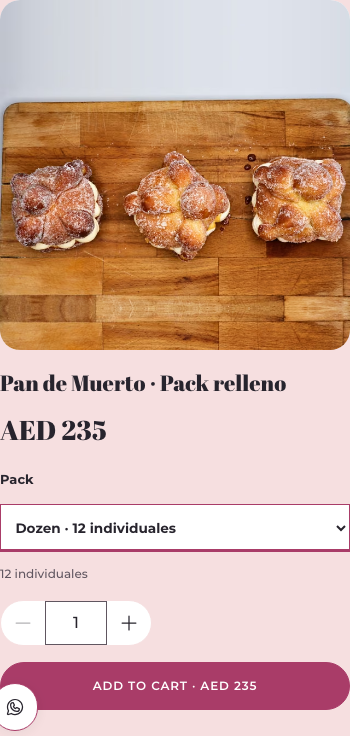
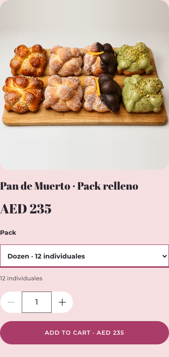
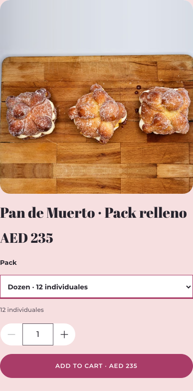

# 3L-MEDIA-001 — Pack relleno primary image

Baseline: `def0c1f8b1a79d97faa9e4b9eddbf0d1b12e23f9`.

The founder approved `02.png` for `pan-de-muerto-filled-pack`. Reuse its existing square `official-pan-02` AVIF/WebP derivatives (320/640/960); no duplicate imports. Only this product's primary assignment changes. Its empty gallery remains empty.

All asset definitions and files remain unchanged, including the historical `official-pan-13-pack` derivative. Crema diplomática still uses `official-pan-14`, `official-pan-14-cutout`, and `official-pan-13`. The historical photo-map CSV remains intact. The regeneration script retains the old derivative while preserving the newly approved primary override; it was not run.

No catalog, price, description, translation, layout, loading, permissions, checkout, server, payment, Meta or Production changes.

## Visual evidence

Card screenshots were captured in Chromium at the stated viewport widths after the image loaded. Existing alt text and lazy loading are preserved. Both widths have square image frames, stable card dimensions, no horizontal overflow, no broken loaded images and no console/page errors. Raw observations: [before](before-evidence.json) / [after](after-evidence.json).

| Viewport | Before | After |
| --- | --- | --- |
| Mobile 390 px |  |  |
| Desktop 1440 px |  |  |

## Validation

- Typecheck, lint, production build: pass.
- Full commerce suite: 572 passed, 0 failed.
- Sites packaging suite: 4 passed, 0 failed.
- Secret scan: 0 findings across 1,324 source/bundle files (heuristic).
- Official media browser regression: Chromium and WebKit at 390/1440 px; exact primary asset, other Pan galleries, square geometry, image loading and animation checks.
- Baseline comparison: identical assets and all other product assignments; exactly one primary source changed; no server, catalog data or asset-file diff.

Build retains existing bundle-size and pending-business-information warnings. Validation uses disposable SQLite and fake providers. No real provider requests, merge or deployment.
