# Conchas integration — local QA evidence

Branch: `feature/3l-conchas-official-image-integration`
Base: `d7b141a5a2f19c080e6dce558cee2c8330c22fed`

## Validation

| Gate | Result |
| --- | --- |
| Typecheck / lint / build | Passed |
| Commerce unit/integration/payment suite | 445 / 445 |
| Preserved Sites tests | 4 / 4 |
| Conchas Chromium / WebKit, 390 / 1440, EN / ES / AR | 16 / 16 |
| Existing checkout Chromium, independent fixture DB | 19 / 19 |
| Existing checkout WebKit, independent fixture DB | 19 / 19 |
| Source hashes | 4 originals + 24 derivatives verified |
| Secret scan | 0 findings |
| npm audit | 0 vulnerabilities |
| Axe product/options EN / ES / AR | 0 violations |
| Browser page errors, RTL and overflow | Passed |
| AVIF → WebP → existing family image fallback | Passed in both engines |

All browser runs used offline local provider fixtures and disposable test databases. No LIVE/TEST provider network call, production data mutation or production deployment was performed. The canonical checkout suite is executed separately per engine so public order-number counters start at the same fixture baseline. An initial `--browser=all` invocation included unavailable Firefox and shared counters between engines; the independent Chromium/WebKit runs above are the final evidence. No checkout test or payment behavior was changed to pass these checks.

Catalog/menu data and all `server/`, `shared/` and PaymentFrame files are byte-identical to the base. The single `Shop.tsx` change passes the existing fallback image into the shared thumbnail renderer; it does not alter checkout requests or calculations.

## Visual comparison

Full-page screenshots, local approved catalog fixture. Menu has only the four released Concha presentation products; unassigned art is never offered for sale. Mobile checkout has its existing order-summary drawer expanded to reveal the thumbnail. Product size selectors are also exercised independently of these captures.

| View | Before | After |
| --- | --- | --- |
| Menu 390px |  | 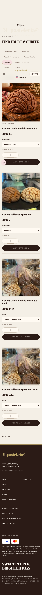 |
| Product 390px | 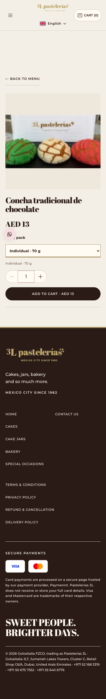 | 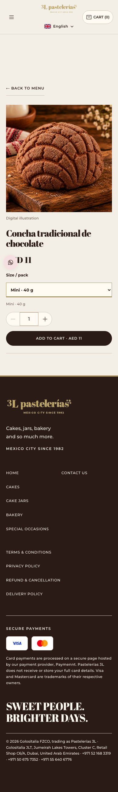 |
| Cart 390px | 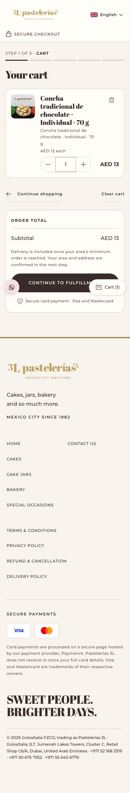 | 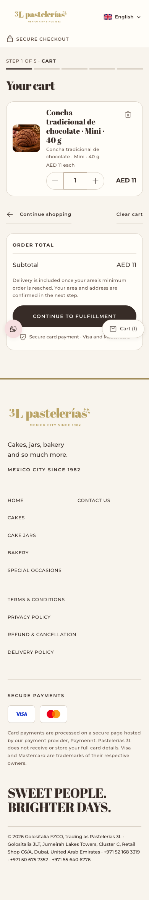 |
| Checkout 390px | 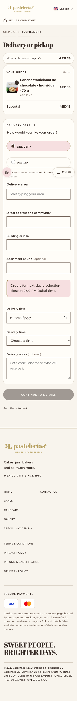 | 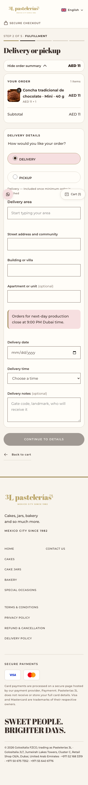 |
| Menu 1440px | 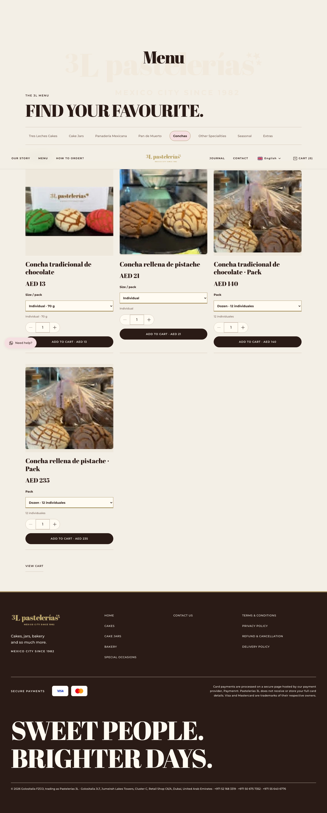 | 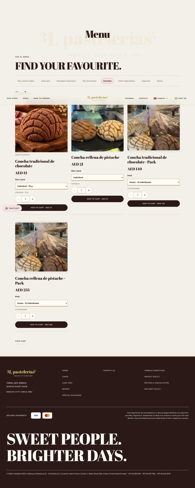 |
| Product 1440px | 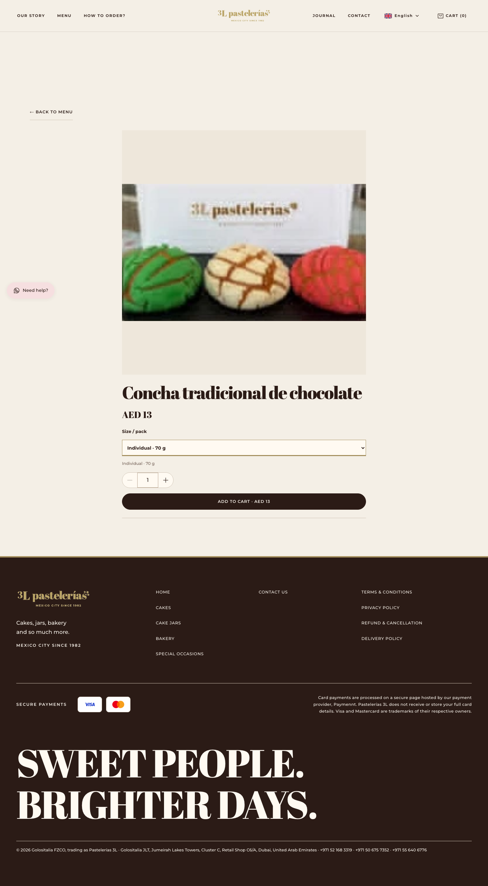 | 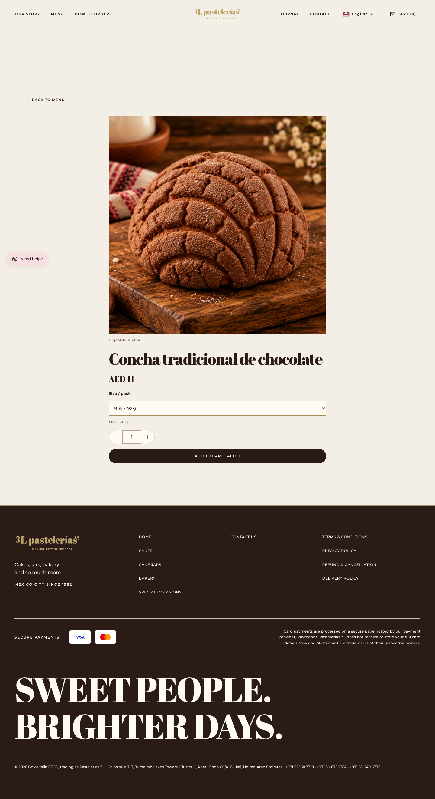 |
| Cart 1440px | 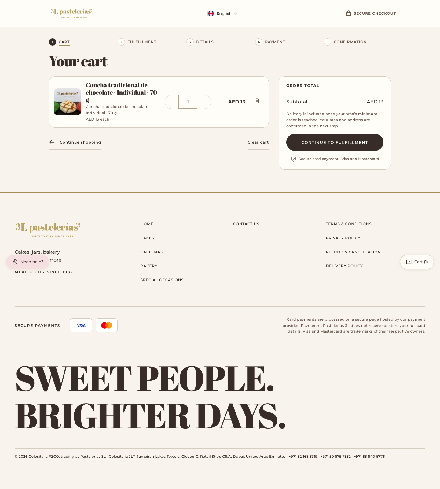 | 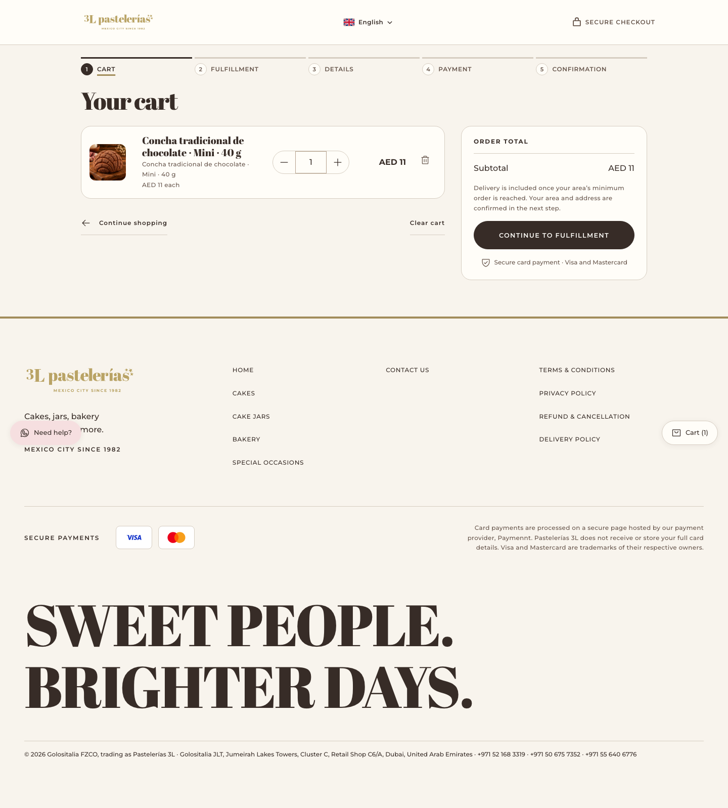 |
| Checkout 1440px | 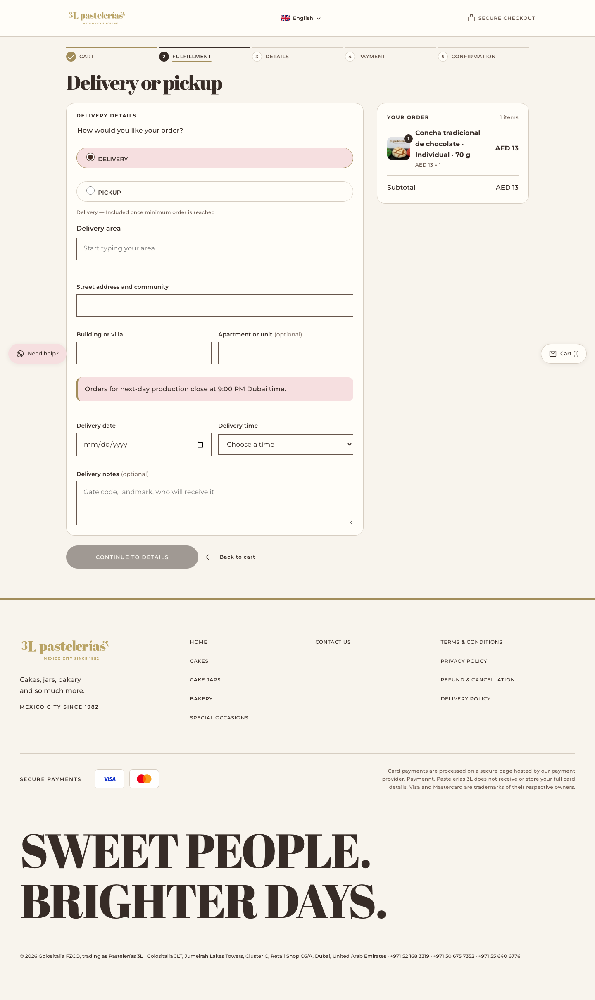 | 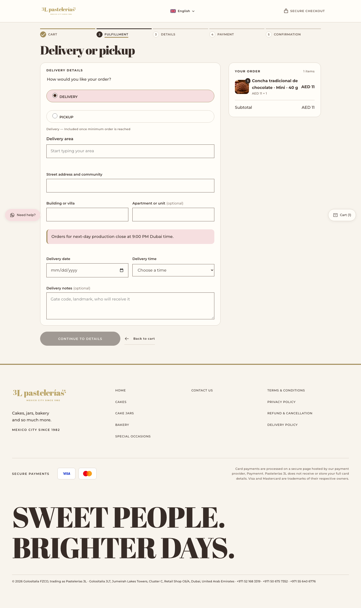 |
