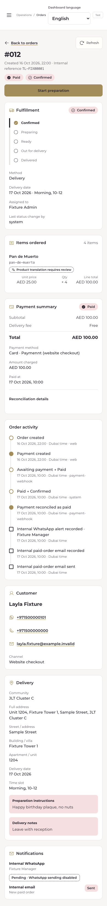
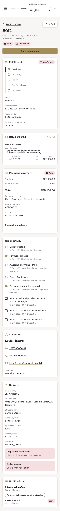
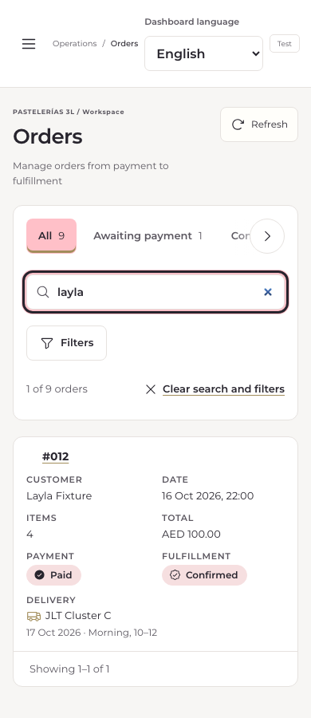

# 3L-OPS-006 — Operations mobile hardening

Baseline: `d7bee2793191dd47d8d7f661059d410f657b1ac4` (fresh origin/main). Branch: `fix/3l-ops-mobile-hardening`. Production has not been changed or used for mutation tests.

## Confirmed findings and minimal fixes

| Finding reproduced on the baseline | Evidence | Fix |
|---|---|---|
| Session expiry depends on the Spanish message substring, not HTTP status | A synthetic 401 with `Session expired` leaves order details on screen instead of login | Typed HTTP errors; 401 clears private workspace data and returns to login, retaining the route |
| A recovered read leaves the old network alert visible | Fail one workspace read, restore transport, refresh: alert remains | Separate identification of read errors; clear only recovered read errors, retain rejected-command errors |
| Refresh triggers launch parallel reads | Hold one read and trigger another refresh: four reads versus three expected, including initial StrictMode reads | Share one in-flight read, invalidate/cancel it before mutations, ignore superseded generations |
| Workspace cannot load when `AbortSignal.timeout` is missing | Remove that static method in a synthetic browser context | Owned AbortController and 15s timer, including body read; cancellation/timeout cleanup |
| Mobile menu target is 38px wide | Baseline Chromium measurement at 320px | Minimum 44px target; drawer/viewport safe-area rules and 16px mobile form text |

Background/online handling was absent. The shared read lifecycle now suspends hidden/offline polling and refreshes on visibility/reconnection. Existing server authorization, order versions, command bodies and idempotency keys remain unchanged. Commands are never retried automatically. Explicit retries after an uncertain response reuse the same key. Synchronous refs close duplicate-submit windows in Operations and login.

The slow-response test protects against an obsolete read overwriting a completed transition. This is regression coverage for the concurrent-read risk, **not a claim that a historical Production order was observed rolling back**.

Visual QA caught tab text overlapping after broadening touch targets. Tabs now refuse flex shrinking; a content-width assertion prevents recurrence. Existing brand colours, sidebar, tables, cards and workflow remain in place. The historical colour-refresh geometry test retains its assertion and explicitly accounts for only the authorized mobile changes.

## Automated evidence

Playwright 1.63.0; synthetic `omsWorkspace` fixtures, intercepted APIs and fake checkout providers only.

- Typecheck, lint, full build: passed.
- Commerce/unit/HTTP integration: **660/660**.
- Full Operations Chromium + WebKit: **132/132** (includes new 40 cases).
- Checkout: **21/21 Chromium + 21/21 WebKit**.
- Original Sites packaging: **4/4**.
- Secret scan: **0 findings**; npm audit: **0 vulnerabilities**.
- Final affected rerun after the tab fix: **70/70 Chromium + WebKit**.
- Axe scans (including contrast), payment badges, historical English tickets/snapshots, RBAC, filters/Back, drawer/Escape/focus, timeout, conflict responses, uncertain response/idempotency, rapid taps, session expiry, offline/reconnect, visibility resume.
- Widths: 320,375,390,430,768,1440 plus412. Reduced-height 420px layout probe represents viewport pressure, not an actual on-screen keyboard.
- Touch emulation: iPhone13, GalaxyS24 and a 412×915 Galaxy S Ultra layout; each run in both engines. An Android user agent in WebKit does not make it Samsung Internet.

The first full unit attempt ran concurrently with the initial build: missing compiled/server assets caused two failures. It was rerun **after** the build. The other initial failure was the old colour-only geometry contract; its explicit expected changes were updated for this authorized sprint. No assertions were removed.

## Browser/device compatibility matrix

| Target | Automated evidence | Physical/device-cloud status |
|---|---|---|
| iPhone Safari | WebKit + iPhone13 touch/viewport simulation | NOT VERIFIED on an actual iPhone |
| iPhone Chrome | WebKit mobile coverage; Chromium profile is extra coverage only | Chrome app/session behavior NOT VERIFIED |
| Android Chrome / recent Galaxy | Chromium + GalaxyS24 touch emulation,412×915 layout | NOT VERIFIED on Android hardware |
| Samsung Internet / Galaxy S Ultra | Shared layout/engine risk covered by simulation only | **NOT VERIFIED**; no Samsung Internet/device-cloud session available |
| macOS Safari | WebKit engine regression | Safari app NOT VERIFIED |
| macOS Chrome | Chromium engine regression | Branded Chrome app NOT VERIFIED |
| Windows Chrome | Chromium engine regression | Windows OS/app NOT VERIFIED |

Do not label these results “Samsung Internet compatible” or “physical-device QA passed.” Before Production approval, run the same scenario list on a recent iPhone (Safari and Chrome) and Galaxy S Ultra (Chrome and Samsung Internet), recording OS/browser version and evidence: login, filtered order/back/scroll, one synthetic transition, 409 rejection, background/lock/resume, airplane mode/reconnect, actual keyboard/address-bar/notch effects, drawer/focus and payment-status display. Use a separately authorized isolated QA environment for mutations, never real Production orders. Device/cloud access is the remaining acceptance gap.

## Visual evidence

All names, addresses and orders in these captures are fixtures.

- Before/after detail: `before/chromium-{320,390,1440}.png` and `after/details-chromium-{320,390,1440}.png`.
- Final list: `after/chromium-390.png`, `after/webkit-390.png`, `after/chromium-768.png`, `after/chromium-1440.png`.
- `after/galaxy-s24-chromium-simulation.png` explicitly represents emulation.

## Release and rollback (not executed)

1. Independent review of the draft PR; real-device acceptance evidence or explicit owner decision on the gap.
2. Separately authorize merge and a controlled code deployment. Inspect main/autodeploy and staged diff first; keep all business/provider variables unchanged.
3. Read-only smoke: health, authenticated login, orders/list/detail, filters/Back, drawer, foreground/reconnect, payment badges. Any state mutation remains isolated QA only.
4. NO-GO for lost authorization, stale visible order state, duplicate mutation, inaccessible critical actions or device failures. This patch introduces no migration or feature flag.
5. On critical regression, roll back only the application build to the immediately preceding approved release, preserving its existing premium-pricing flags and dynamic catalog. Never restore old SQLite over live transactions. No price/catalog/provider changes are part of this rollback.

No merge, deployment, database migration, real order mutation, email, payment or change to Paymennt/Meta/Resend configuration occurred in this sprint.
