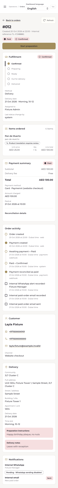
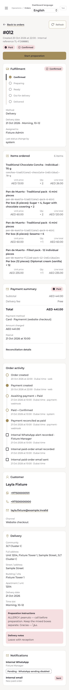

# 3L-OPS-MOBILE-002 — review readiness

Baseline: current main `17dc5fbdf371a534c68af6d34b563eda10a9ffbf`. Existing branch/PR: `fix/3l-ops-mobile-hardening` / #41. The initial head was `c52995fba7f64906223e10b5e712aa5b15bfe59e`; it was clean, draft and conflicting. This follow-up preserves its implementation and updates it with main without rewriting published history.

## Integration and demonstrated fixes

- Preserve main's shared `Login` extraction and Analytics route. Move the existing synchronous login-submit guard into that shared component instead of restoring a duplicate Login inside Workspace.
- Combine the three mobile transport/status translations with all current EN/TL Analytics resources. No runtime translation, product definition or financial wording change.
- Retain cancellable single-flight reads, generation checks, typed401 handling, visible/offline refresh lifecycle and same-event mutation guards. Existing command bodies, versions and explicit-retry idempotency keys are unchanged. No automatic command retry.
- **New reproduced branch defect:** if a successful login response arrives while hidden, the workspace refresh is deliberately skipped, but the expired-session latch previously prevented every subsequent foreground refresh. The retained failing trace ends back on Login instead of the order. On successful authentication the latch now releases; private data still renders only after an authorized workspace response. The regression passes in both engines, retaining the route.
- Current-main negative controls reproduce the four original issues: non-Spanish401 handling, retained recovered-read errors, overlapping reads and missing `AbortSignal.timeout`. These controlled failures are baseline evidence, not candidate passes.
- A local port conflict was traced to Claude's existing SEO worktree. It was not stopped or modified. `OPERATIONS_E2E_PORT` now selects an isolated local port (default3242 remains unchanged in CI); manually created device contexts reuse that configured origin.

The protected `server/http.ts`, `shared/seo.ts`, `src/brand/Root.tsx`, catalog sources, pricing, provider code and financial contracts remain identical to the baseline. There is no Production/Railway access or mutation in this work.

## Critical flow matrix

| Flow | Automated evidence |
|---|---|
| Login/expiry/relogin | HTTP401 independent of message language, non-JSON401 transport, duplicate form submit, same filtered route, login completed while hidden |
| Reads/refresh | One in-flight workspace read; recovered network errors clear; superseded read cannot overwrite a completed transition |
| Connectivity | Offline advisory, mutation guard, reconnect refresh, hidden/resume lifecycle, no unsolicited writes |
| Commands | Rapid taps produce one versioned command;409 rejection remains visible; uncertain/lost response does not auto-retry; explicit retry retains key |
| List/detail | Search/filter/Back/history preserved; existing direct-link, refresh, missing-order and permissions tests retained |
| Frozen preparation/finance | EN/TL at390/412px: separate same-SKU box compositions, physical quantities, accepted unit/line/paid amounts and complete original allergy/multilingual notes remain unchanged after current catalog names/prices are altered in the synthetic fixture |
| Mobile geometry | 320/375/390/412/430/768/1440px;44px controls; safe areas, viewport pressure, drawer/Escape/focus and readable form fields |
| Accessibility | Axe including contrast on each of six order/kitchen routes at390/1440px in both engines; existing scans retained |
| Device profiles | iPhone13, iPhone17Pro, GalaxyS24 and412×915 S Ultra layout; simulation only |

All orders, contacts, accepted amounts and mutations in these tests are synthetic. No provider request, real email, real payment or real order transition was executed.

## Historical CI investigation

Run39032160799 has no retained artifacts/traces. Its logs show two distinct failures:

1. Operations WebKit job117394661474: Tagalog390px `dashboard.spec.ts:83`, horizontal-overflow predicate false,65/66 passed. The logs do not identify the overflowing element. Current main passes this complete nine-view scenario locally; the candidate retains the same predicate and full EN/TL responsive coverage. No overflow was hidden and no assertion relaxed. Exact historical causality remains unproven without a retained trace; this is not labelled a flake.
2. Packs job117394661325: the actual failure was **checkout**,20/21 WebKit, timing out in `mockReturn` while navigating to `/checkout/return` before payment assertions. Pack/premium tests had passed24/24 each. Checkout application code is unchanged relative to current main. Main already includes later fixture synchronization, Playwright1.64 and a Linux libsoup>=3.6.6 guard. Those updates are preserved, not reimplemented or treated as forensic proof of the old navigation failure.

The current workflow retains failure traces/screenshots and process diagnostics. Final exact-head CI is mandatory; old CI/local successes are not substituted for it.

## Additional QA findings and limits

The first local complete commerce run passed716/717; one unmodified HTTP-worker fixture did not emit readiness within its10s harness budget while local browser work was running. An isolated recheck passed in1.1s. No Meta/runtime/test timeout change was made. Exact final-head default CI must pass the complete suite; the initial failure remains in the private QA logs.

The first Operations run passed141/142. Its trace shows all six accessibility routes completed navigation and the final axe scan exceeded their shared30s cumulative test budget. Each route now has its own case with the same normal timeout and every original contrast/violation assertion. The fixed150ms wait was removed in favor of the existing content-ready assertion. This does not raise timeouts, skip scans or mask an accessibility violation. Final full CI includes every route independently.

Local commands use `OPERATIONS_E2E_PORT=3341 npx playwright test --config=playwright.operations.config.ts`; main comparisons use3342. Canonical typecheck/lint/build, commerce tests, checkout/packs regressions, Sites, dependency audit and secret scan are required. Exact final counts, SHA and CI URLs are recorded in the PR description after completion.

## Before/after evidence

Current-main and candidate detail captures use the same `omsWorkspace` fixture and viewport, with no real customer data. Existing identity, order sections and navigation remain.

The current-main mobile menu measured38px wide; the candidate asserts at least44×44px. Additional320/412/1440px and EN/TL images are in `sprint02/`. This is a functional hardening pass, not a visual redesign.

## Physical-device acceptance and controlled release

No physical iPhone, Android phone, Samsung Internet or device-cloud session was available. An iPhone17Pro Playwright profile is not the founder's actual iPhone18Pro; a412px Chromium layout is not Samsung Internet certification. A reduced-height viewport is not an actual virtual-keyboard test. Record OS/browser versions and perform login, filtered list/detail/Back/scroll, background/lock/resume, airplane-mode/reconnect, keyboard/browser-bar/safe-area and drawer checks on an iPhone Safari and Android Chrome before Production acceptance. Any transition test must use a separately authorized isolated environment.

Independent review and founder merge/deploy approval remain separate. No merge to main or deployment is performed here. A later controlled deployment must keep business/provider configuration unchanged and stop for authorization loss, stale order state, duplicate actions or inaccessible critical controls. Roll back application code only to the preceding approved build; never restore old SQLite over new transactions. This patch adds no migration or feature flag.
