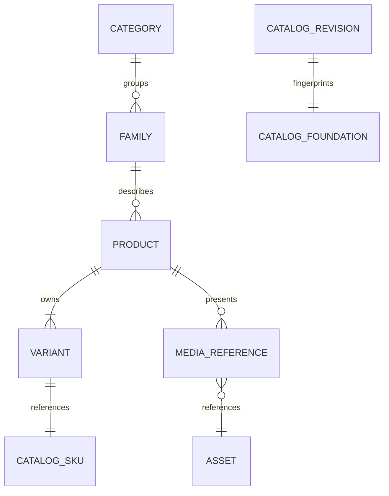

# Sprint 1A — catalog foundation (shadow read only)

## Baseline and isolation

Main: `e2a82387549d5861e110178d6b9c8b8ae7f84f10`. PR #6:
`14484ab0eef21c64732ea744c31eb3f6761839c3`, open at inspection. Branch:
`feature/3l-product-hub-catalog-foundation` starts from main, not PR #6.
The Conchas worktree contains uncommitted filled-collection work. It is excluded,
untouched and not a catalog authority for this sprint. The canonical checkout
worktree and its existing stash are also untouched. Counts below describe the
approved file at this baseline; no LIVE database count was queried.

Sprint 0 audit was reviewed: CornerTech Products UI is read-only, its Supabase
repository can fall back to memory, and 3L menu/media/translations depend on the
build. The hosted-payment worker's current-catalog reads require protection in
Sprint 1B before any dynamic commercial writes.

## Smallest additive model

`State.catalog` remains the **only** authority for SKU prices and availability.
The optional `State.catalogFoundation` contains relationships, translations,
asset references and a revision; it does not contain a second price list.
No SQL tables, Store constructor migrations, infrastructure or dependencies are
added. Existing aggregate transactions and online backups remain compatible.



- Product: stable authored ID/slug, category/family, name, description, state,
  display order, EN/ES/AR content and ordered primary/gallery references.
- Variant: existing SKU ID, parent, original flavor/size labels, pack quantity,
  commercial state, translations and media. Price/availability join `catalog`.
- Family: existing identity, category, pack flag and advance-order flag. This
  preserves existing metadata; it does not alter lead-time or delivery policy.
- Asset: stable ID derived from existing source identity, version hash of the
  derivative references, existing file paths/dimensions, localized alt text.
  This is reference-version metadata, not a claim of hashing image bytes.
- Revision: schema version 1, deterministic SHA-256 and `catalog-v1-<hash>`.
  `publishedAt:null` means the historical publication timestamp is unknown;
  bootstrap does not invent a date or enable a new publication workflow.

Strict Zod schemas reject unknown fields. Validation enforces case-insensitive
identity uniqueness, unique slugs, complete SKU representation, family/category
and parent relationships, media references, one primary image, gallery order,
pack quantity, translation shapes and positive safe integer prices. Revision
hashes cover metadata and the authoritative catalog. Drift fails closed rather
than silently exposing a mismatched revision.

## Reproducible bootstrap and reconciliation

`loadBootstrapSources` is tooling only: the runtime API never reads source JSON.
It examines the approved catalog, authored products/families, current media
precedence (official Pan first), category galleries and locale source-index.

Source-file reconciliation: **236 SKUs / 216 active / 20 inactive**, all prices
and identities preserved; 29 families; 74 public products. Twenty inactive SKUs
are no longer represented in the current public menu. They remain in their
original authoritative records and receive private technical archival parents,
not new purchasable products. Their missing family/size/flavor metadata stays
null and is explicitly listed for review. Total internal product nodes: 94.
No retired combination or inactive filled Concha is reactivated.

Existing empty size labels (e.g. candles) are represented as null, not guessed.
Packs retain explicit source quantities, including 4/6 cake-jar bundles and
6/12 bread packs. No assortment rules are added. Translation lookups retain
available source content; missing translations remain null and are reported.
All 74 public product titles have ES/AR translations at this baseline. This
statement does not imply every asset alt or description has a translation.

Artifacts: `sprint-1a-dry-run.json` and `sprint-1a-reconciliation.json`.
These are review evidence, not independently editable runtime price sources.

### Local commands only

Use a **disposable, already initialized** test/development SQLite database whose
catalog matches the approved baseline. Never point these commands at LIVE.

```sh
APP_ENV=test NODE_ENV=test DB_PATH=/absolute/disposable/state.sqlite npm run catalog:foundation -- audit
APP_ENV=test NODE_ENV=test DB_PATH=/absolute/disposable/state.sqlite npm run catalog:foundation -- apply
```

Dry-run uses a read-only SQLite connection, verifies runtime profile and prints
the report before writes. Apply recomputes the plan inside `Store.write` and
adds only `catalogFoundation`. Conflicting source prices/names/status, unknown
active mappings or existing different foundations abort. A repeat is a no-op
in logical state and creates no duplicates. Production, staging and mismatched
profiles are rejected by the CLI. No destructive catalog import is performed.
There is intentionally no bundled Production migration command.

## Read-only API

`CATALOG_READ_API_ENABLED=false` by default. Setting true permits test,
development or staging reads only when NODE_ENV is not production. Both
APP_ENV=production and NODE_ENV=production prohibit the API even if the flag is
set. No storefront consumer changes in Sprint 1A.

- `GET /api/catalog?locale=en&category=conchas&limit=30&offset=0`
- `GET /api/catalog?slug=conchas-traditional--chocolate&locale=ar`
- `GET /api/catalog/products/conchas-traditional--chocolate?locale=es`

Locale: en/es/ar. Limit: 1–100; offset: 0–10000. Unknown/duplicate query keys,
malformed IDs and invalid parameters are rejected. Product lookups accept exact
stable IDs or slugs; unpublished/archival products are 404. No write routes.

Response: schemaVersion, revision, locale, total/offset/limit, categories,
families, products with variants, and only referenced assets. Explicit
projection excludes draft-only products/variants and private provenance,
source filenames, approval notes or arbitrary administrative metadata.
Prices are integer fils, currency AED; availability also applies existing
seasonal restrictions. Pack quantities and selected locale content are explicit.
Missing translated text remains null, without fabricated translations.

`Cache-Control: no-cache, max-age=0, must-revalidate`; ETag hashes the response
including locale, pagination and seasonal availability. Conditional GET returns
304. Missing foundation is 503. Reads call only Store.read; there is no seeding,
migration, provider call, publication or write side effect.

## Actual reuse decisions and licensing

CornerTech main `f74b5dcfe920ac5849b352745ebdc5f83ae37bc2`; pending #91
`22c8510559b6a583a7a13b63301e79cdfe1b7d10`; #92
`f6332f4fc5cfa36447c02f123567fb46046a30c0` (stacked on #91).

| Candidate | Decision for actual code | Reason |
| --- | --- | --- |
| CornerMexProductContract / contractFactory | Do not copy; implement native Zod contract | Flat B2B contract lacks 3L relationships; proprietary license |
| SKU normalization in productRepository | Do not copy | Case/accent normalization cannot rewrite authored SKU IDs |
| SellerCatalogCapturePolicy | Concepts only | Bounded validation useful; supplier domain/dependencies excluded |
| Audit sanitization utilities | Not required in 1A | Explicit API whitelist avoids introducing an audit service |
| Supabase repository / SupplyGraph stores | Excluded | No database/service connection or PostgreSQL dependency |
| Existing 3L Zod, CatalogItem, Store.write/read/backup | Reuse directly | Existing authority and transactional protection |
| Existing seasonal policy / manifests / locale resources | Reuse existing data and policy | No commercial or visual policy changes |

No restricted CornerTech source was copied. New functions are independently
implemented with standard validation, hashing and explicit projection patterns.

## Safety, rollback and next gates

No admin UI, uploads, price editing, publish endpoint, LIVE migration, provider
call or deployment is implemented. `.env.example` is a placeholder only.
Paymennt, webhook, reconciliation, checkout snapshots, order workflow, delivery,
pickup and frontend files are unchanged. CI has validation only, no deployment.

Rollback this code or keep the flag disabled; optional metadata can remain in
SQLite unused. For a disposable development migration, restore the verified
pre-bootstrap backup only within the isolated test environment. Never restore a
whole LIVE database over newer transactions. Future commercial rollback must
be selective and versioned.

Sprint 1B: protect frozen checkout prices through queued creation/retry/resume;
then define revision/availability behavior before dynamic storefront publication.
Sprint 2: administrative editor, publication permissions/concurrency/history,
uploads/durable media, translation management and dynamic storefront adoption.
The 20 archival mappings require explicit commercial review before any proposed
reactivation; they are not blockers for preserving the inactive baseline in 1A.

## Sprint 1A validation

- Typecheck, lint and production build: pass.
- Full commerce suite: 456 passed, zero failed/skipped (nine new contract/bootstrap/API tests).
- Sites suite: four passed.
- Existing checkout regressions: Chromium 19 passed; WebKit 19 passed.
- Secret scan: zero findings; npm audit: zero vulnerabilities.
- Disposable SQLite bootstrap repeated without logical changes; backup restored with integrity check and preserved frozen order/payment/receipt/zone fixtures.
- No runtime provider calls, LIVE database access, deployments or Production variable changes were performed.
